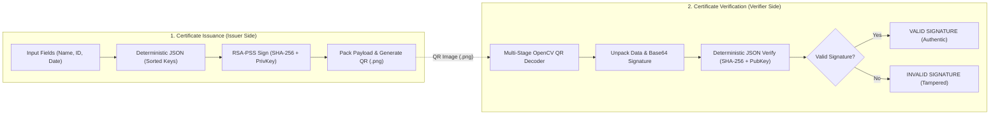
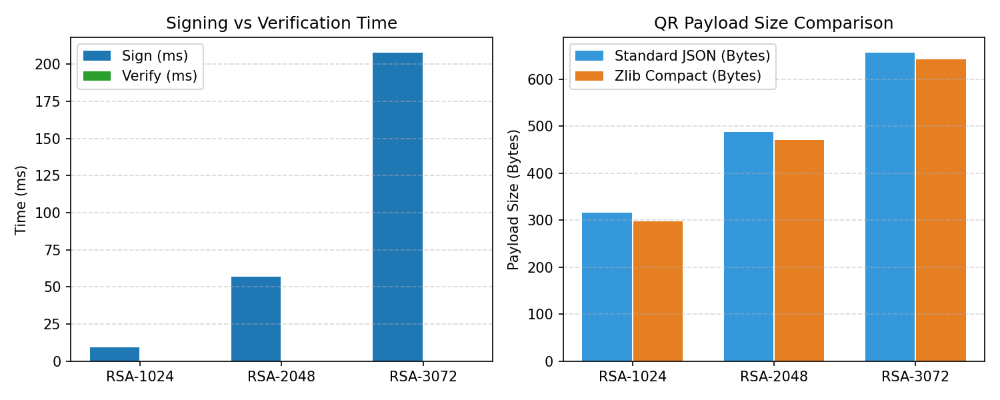
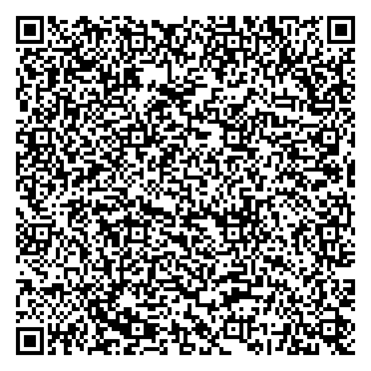

# COVER PAGE *(Excluded from Page Limit)*

**PROJECT REPORT — CRYPTOGRAPHY**

**Title:** Design and Implementation of a QR Code-Based Digital Certificate Verification System Using RSA Digital Signatures  

- **Course:** Cryptography (2026–2027)
- **Institution:** University of Science and Technology of Hanoi (USTH)
- **Date:** November 2026

### Member List & Student ID
| No. | Full Name | Student ID |
| :---: | :--- | :---: |
| 1 | Nguyễn Khải Điệp | 23BA14051 |
| 2 | Doãn Trung Dũng | 23BA14070 |
| 3 | Nguyễn Đinh Huyền Mai | 23BA14186 |
| 4 | Lương Quỳnh Anh | 23BA14008 |
| 5 | Phạm Vũ Khánh | 23BA14148 |
| 6 | Đặng Thế Hiệp | 23BA14103 |
| 7 | Nguyễn Phương Nam | 23BA14206 |

---

# TABLE OF CONTENTS & LIST OF FIGURES *(Excluded from Page Limit)*

### Table of Contents
1. **Introduction**
   - 1.1 Background and Problem Statement
   - 1.2 Objectives and Explicit Scope Boundaries
2. **Theoretical Background and Weakness Analysis**
   - 2.1 Cryptographic Primitives & RSA-PSS Mechanics (Salt Configuration)
   - 2.2 Reproducing Textbook RSA Weakness (Multiplicative Forgery)
3. **System Design and Implementation**
   - 3.1 System Architecture and Operational Workflow
   - 3.2 Robust Multi-Stage QR Decoding Pipeline
   - 3.3 Payload Optimization Scheme and Security Considerations
4. **Experimental Evaluation and Conclusion**
   - 4.1 Security and Tamper Detection Test Cases (Demonstration vs. Evaluation)
   - 4.2 Automated 100-Run Stress Testing & Performance Benchmark
   - 4.3 Limitations and Conclusion
- **References & Annexes**

---

<!-- ==================== MAIN CONTENT STARTS HERE ==================== -->

## 1. Introduction

### 1.1 Background and Problem Statement
Academic institutions, testing agencies, and professional organizations increasingly distribute digital credentials rather than conventional physical paper documents. However, plain electronic documents and simple printed QR codes remain acutely vulnerable to unauthorized manipulation. A typical QR code merely encodes plain text or an external URL; it provides no inherent cryptographic assurance regarding data integrity or issuer authenticity. If an adversary alters the recipient's name or certificate identifier and regenerates the optical code, a standard camera scanner cannot detect the modification.

Furthermore, existing verification infrastructures frequently mandate persistent internet connectivity to query centralized databases or validation web services. In scenarios with server downtime, network congestion, or remote operational environments (e.g., field audits, border crossings, or emergency operations), online verification completely fails. This project addresses these challenges by developing an **offline, stateless QR code verification prototype** using **RSA-PSS digital signatures** with **SHA-256**.

### 1.2 Objectives and Explicit Scope Boundaries
The primary technical objectives of this project are:
1. Standardize certificate fields into a deterministic JSON serialization and sign them using RSA-PSS with SHA-256.
2. Reproduce the mathematical vulnerability of unpadded (Textbook) RSA to demonstrate why probabilistic padding (RSA-PSS) is cryptographically mandatory.
3. Package certificate data, Base64 signature, and key ID into an optical QR code, evaluating standard JSON packaging alongside a compact binary packing scheme.
4. Implement a resilient multi-stage OpenCV decoding pipeline designed to improve decoding of dense QR codes and verify signed payloads.

**Project Scope Boundaries:**
- **Included in Scope:** Standalone local Python Command-Line Interface (CLI); RSA key pair generation (1024, 2048, 3072-bit); deterministic JSON serialization; RSA-PSS signing and verification with SHA-256; multi-stage OpenCV QR decoding; five scripted security test scenarios; an automated 100-run stress test; and quantitative performance benchmarking.
- **Explicitly Out of Scope:** Web applications, graphical user interfaces, centralized databases, user account systems, online revocation protocols (CRL / OCSP), and production-grade Hardware Security Modules (HSM). The verifier is assumed to possess the authentic public key of the issuing organization via a trusted out-of-band channel.

---

## 2. Theoretical Background and Weakness Analysis

### 2.1 Cryptographic Primitives & RSA-PSS Mechanics
The system integrates four complementary primitives, summarized in Table 1.

| Component | Role in the System |
| :--- | :--- |
| **RSA-PSS** | Probabilistic signature scheme (PKCS #1 v2.2 / RFC 8017 [1], FIPS PUB 186-5 [3]) providing integrity and cryptographic origin authentication relative to a trusted public key. |
| **SHA-256** | Cryptographic hash function generating a 256-bit collision-resistant message digest (FIPS PUB 180-4 [2]). |
| **Private / Public Key** | Private key $(d, n)$ retained by the issuer to sign data; Public key $(e, n)$ distributed to verifiers. |
| **QR Code (2D Barcode)** | Optical transport layer encoding the signed payload (ISO/IEC 18004 [4]); provides optical data transfer without inherent security. |

In standard RSA key generation, two large distinct prime numbers $p$ and $q$ are selected to compute modulus $n = p \cdot q$ and Euler's totient $\phi(n) = (p-1)(q-1)$. Given public exponent $e = 65537$, the private exponent $d$ is derived via:

$$d \equiv e^{-1} \pmod{\phi(n)}$$

**The Mechanics of RSA-PSS and Salt Configuration (RFC 8017 [1]):**  
RSA-PSS (Probabilistic Signature Scheme) is designed to provide existential unforgeability under chosen-message attacks under the RSA assumption and the scheme’s security model (Bellare & Rogaway, 1996 [5]):
1. **Hashing:** The deterministically serialized message $M$ is hashed to produce $mHash = \text{SHA256}(M)$ ($hLen = 32$ bytes).
2. **Salt Length Configuration:** In our implementation (`salt_length=padding.PSS.MAX_LENGTH`), the salt uses the maximum length allowed by the encoded message size. RFC 8017 [1] defines $emBits=modBits-1$, $emLen=\lceil emBits/8 \rceil$, and $sLen_{max}=emLen-hLen-2$. For RSA-2048 with SHA-256, $emBits=2047$, $emLen=256$, and $sLen_{max}=256-32-2=222$ bytes.
3. **Encoding:** The prefix $\text{0x00...00} \parallel mHash \parallel s$ is hashed to form $H$. MGF1 with SHA-256 masks the data block $DB = \text{PS} \parallel \text{0x01} \parallel salt$, yielding encoded octet string $EM = \text{maskedDB} \parallel H \parallel \text{0xBC}$. The implementation uses SHA-256 for both MGF1 and the message hash.
4. **Exponentiation:** The octet string $EM$ is converted to an integer and signed: $s_{sig} = EM^d \bmod n$.

### 2.2 Reproducing Textbook RSA Weakness (Multiplicative Forgery)
To mathematically justify why RSA-PSS is required, we implemented `demo_textbook_rsa_forgery` in [`crypto_utils.py`](file:///d:/Coding%20Practise/Studying%20at%20USTH/2026_2027/Cryptography/Midterm/QR-Digital-Signature/midcrypto/crypto_utils.py). In raw Textbook RSA, signing computes $s = m^d \bmod n$ and verification checks $s^e \equiv m \pmod n$. Because modular exponentiation is strictly multiplicative:

$\big[(m_1^d \bmod n)(m_2^d \bmod n)\big] \bmod n = (m_1m_2)^d \bmod n$

An attacker intercepting two valid message-signature pairs $(m_1, s_1)$ and $(m_2, s_2)$ can forge a valid signature $s_3$ for the composite message $m_3 = (m_1 \cdot m_2) \bmod n$ without knowledge of the private exponent $d$:

$$s_3 = (s_1 \cdot s_2) \bmod n$$

**Experimental Verification:** In our automated test (`run_tests.py`) using an RSA-2048 key, messages $m_1 = 105$ and $m_2 = 200$ were signed to obtain $s_1$ and $s_2$. The forged signature $s_3 = (s_1 \cdot s_2) \bmod n$ was verified against $m_3 = 21000$. The check $s_3^e \bmod n == 21000$ returned **`is_forged_valid = True` (Multiplicative forgery succeeds)**.

**Why RSA-PSS Resolves This Vulnerability:** RSA-PSS does not apply the raw-message signing operation used in Textbook RSA. It encodes the message using a hash, a salt, and MGF1 before applying the RSA private-key operation. The multiplicative property demonstrated above therefore cannot be directly used to construct a valid RSA-PSS signature. RSA-PSS is designed to provide existential unforgeability under chosen-message attacks under the assumptions of its security model.

---

## 3. System Design and Implementation

### 3.1 System Architecture and Operational Workflow
The prototype presents two logical roles, **Issuer** and **Verifier**, as separate menu operations within one Python CLI application (Figure 1); they are not independently deployed applications.


*Figure 1: End-to-End Certificate Issuance and Verification Workflow.*

1. **Step 1 (Data Normalization):** Given raw certificate inputs, `normalize_cert_data()` serializes the dictionary into deterministic JSON with lexicographically sorted keys (`sort_keys=True`) and compact separators (`separators=(",", ":")`), producing consistent bytes for the supported fields. Unicode NFC normalization is not implemented.
2. **Step 2 (Signing):** `sign_data()` computes the SHA-256 digest of the deterministic JSON string and generates an RSA-PSS signature with the issuer's private key (`salt_length=MAX_LENGTH`, producing 222 bytes of salt for RSA-2048).
3. **Step 3 (QR Packaging):** The data dictionary, Base64 signature, and key identifier (`kid="EDU-2026"`) are packed into a single payload string and rendered into a QR image using `qrcode` (error correction level M). The key ID is included for reference; the verifier loads a PEM public key from a user-specified path and does not use the ID for automatic key lookup.
4. **Step 4 (QR Decoding):** `decode_qr_image()` extracts the raw payload text from image bytes using a multi-stage decoding pipeline.
5. **Step 5 (Verification):** `unpack_qr_payload()` parses the payload. `verify_signature()` re-normalizes the extracted certificate dictionary and verifies the RSA-PSS signature against the trusted public key.

### 3.2 Robust Multi-Stage QR Decoding Pipeline
The decoder cascade was compared with OpenCV `QRCodeDetector()` on 100 saved, software-generated QR Version 17 images (744 x 744 px, EC=M). The dataset reuses one certificate-field fixture and creates a fresh RSA-PSS signature with randomized salt for each image; it contains no blur, rotation, resizing, noise, or camera captures. After one unmeasured warm-up per method, each PNG was timed three times through both the standard detector (including PNG decoding) and `decode_qr_image()`. Mean latency uses all calls, with no outlier removal. Per-image outcomes, PNGs, and environment details are in `sample_qrs/decoder_eval/` and the generator is `benchmark_qr_decoders.py`.

The saved comparison measured 80/100 baseline successes (20 failures, 77.711 ms mean) and 100/100 pipeline successes (0 failures, 98.500 ms mean). On this synthetic set the pipeline removed the 20 observed baseline failures at about 27% higher mean latency. It does not establish performance on camera-captured or damaged QR images. The pipeline in [`qr_utils.py`](file:///d:/Coding%20Practise/Studying%20at%20USTH/2026_2027/Cryptography/Midterm/QR-Digital-Signature/midcrypto/qr_utils.py):
1. **Dual Detector Cascade:** Prioritizes OpenCV 4.7+ `cv2.QRCodeDetectorAruco()` with automatic fallback to classic `cv2.QRCodeDetector()`.
2. **Multi-Stage Preprocessing Fallbacks:**
   - *Stage 1:* Direct color BGR decoding.
   - *Stage 2:* Grayscale conversion.
   - *Stage 3:* Quiet Zone padding (`cv2.copyMakeBorder` with 20px and 40px constant white margins, following ISO/IEC 18004 [4]), assisting OpenCV in locating finder patterns.
   - *Stage 4:* Otsu binarization (`THRESH_BINARY | THRESH_OTSU`) with margin padding.
   - *Stage 5:* Multi-scale resizing with `INTER_NEAREST` interpolation (avoiding the anti-aliasing blur caused by bilinear resizing).

### 3.3 Payload Optimization Scheme and Security Considerations
- **Payload Scheme Evaluation:** A 2048-bit RSA signature produces 256 raw bytes (344 Base64 characters). Because cryptographic signatures have maximal entropy, attempting to compress an already-Base64-encoded JSON payload inflates the size. Our compact scheme (`pack_qr_payload(..., use_compression=True)`) compresses only the metadata dictionary via `zlib` (level 9), prepends a 2-byte length header, appends the raw 256 binary signature bytes, and encodes the combined stream to Base64 once with prefix `C:`.  
  *Measured Result:* For RSA-2048, standard JSON produces 488 bytes while the compact format produces 470 bytes (a modest **3.69% reduction**), both fitting within QR Version 17. While technically valid as an optimization proof-of-concept, the standard JSON format was retained as default for human readability.
- **Key Storage Sandbox:** For educational CLI simplicity, `sample_keys/private_key.pem` is serialized without a passphrase (`NoEncryption()`). In an operational production deployment, private keys must be protected with strong password-based encryption (e.g., PKCS#8 with PBKDF2 / AES-256) or managed through Hardware Security Modules (HSM) / cloud KMS.

---

## 4. Experimental Evaluation and Conclusion

### 4.1 Security and Tamper Detection Test Cases
To evaluate the integrity and authenticity guarantees of the system, we distinguish between **demonstrating** cryptographic functions and **evaluating** security behaviors under simulated attacks. Five scripted verification scenarios in [`run_tests.py`](file:///d:/Coding%20Practise/Studying%20at%20USTH/2026_2027/Cryptography/Midterm/QR-Digital-Signature/midcrypto/run_tests.py) provide empirical evidence (Table 2).

| Test ID | Objective & Experimental Condition | Input Condition | Expected Result | Actual Execution Output | Status |
| :--- | :--- | :--- | :--- | :--- | :---: |
| **TC-01** | *Demonstrate* valid issuance and verification | Authentic QR image + matching RSA-2048 Public Key | `Valid Signature` | **Valid Signature** | **PASS** |
| **TC-02** | *Evaluate* data tamper detection | Recipient modified (`Nguyen Van A` $\rightarrow$ `Nguyen Van B (Fake)`) | `Invalid Signature` | **Invalid Signature** | **PASS** |
| **TC-03** | *Evaluate* signature tamper detection | First 10 Base64 characters modified in signature payload | `Invalid Signature` | **Invalid Signature** | **PASS** |
| **TC-04** | *Evaluate* issuer authenticity enforcement | Authentic QR verified against an unauthorized RSA-2048 Public Key | `Invalid Signature` | **Invalid Signature** | **PASS** |
| **TC-05** | *Evaluate* error handling on invalid media | Corrupted/non-image byte stream fed to decoder | Graceful error report | **Error: Cannot decode QR code** | **PASS** |

The tested data modification (TC-02), signature alteration (TC-03), and unrelated public key (TC-04) were rejected. Copying an intact valid QR code is outside these tests and is not detected by this prototype.

### 4.2 Automated 100-Run Stress Testing & Performance Benchmark
The script runs 100 iterations, each signing the same certificate data, generating a QR image, decoding it, and verifying the signature. The isolated recorded run completed 100/100 iterations successfully in 26.80 seconds; its full output is saved in `sample_qrs/decoder_eval/run_tests_output.txt`. These results apply to generated images and do not establish physical camera-scanning reliability.

For each key size, the script generates a key once outside the timer and uses the same normalized message for 30 signing and 30 verification calls. It times with `time.perf_counter()` and reports arithmetic means without warm-up or outlier removal. Each call includes helper overhead (PEM loading; verification also decodes Base64); key generation and QR operations are excluded. Environment: Windows 11, Python 3.14.2, Cryptography 50.0.2, OpenCV 4.13.0. Table 3 and Figure 2 summarize the measured data.

| Key Size | Signing Time (ms) | Verification Time (ms) | Raw Signature / Base64 | Standard JSON Payload | Compact Payload (`C:`) | QR Version (EC=M) |
| :---: | :---: | :---: | :---: | :---: | :---: | :---: |
| **RSA-1024** | 13.093 ms | 0.032 ms | 128 B / 172 chars | 316 Bytes | 298 Bytes ($-5.70\%$) | Version 13 ($69 \times 69$) |
| **RSA-2048** | 69.990 ms | 0.163 ms | 256 B / 344 chars | 488 Bytes | 470 Bytes ($-3.69\%$) | Version 17 ($85 \times 85$) |
| **RSA-3072** | 127.758 ms | 0.064 ms | 384 B / 512 chars | 656 Bytes | 642 Bytes ($-2.13\%$) | Version 20 ($97 \times 97$) |

  
*Figure 2: (Left) Signing vs. Verification Time across RSA key sizes; (Right) QR Payload Size Comparison.*

**Environmental Variance Note:** Benchmark execution latencies vary according to CPU performance and runtime environments. For instance, testing on Python 3.13.5 with Cryptography 46.0.4 produced signing times of 5.51 ms (RSA-1024), 40.28 ms (RSA-2048), and 116.00 ms (RSA-3072). For these recorded measurements:
1. Verification is sub-millisecond in this run. Signing-to-verification ratios are approximately 409x, 429x, and 1,996x for RSA-1024, RSA-2048, and RSA-3072, respectively. The short verification times are noisy and need not grow monotonically with key size; the small public exponent $e=65537$ explains why they remain much lower than signing times.
2. At RSA-2048, compact packing saves 18 B (3.69%) but keeps QR Version 17, so capacity benefit is small for this fixture.
3. **Parameter Selection:** RSA-2048 is the prototype default (conforming to modern digital signature recommendations [3]), with an approximate 112-bit security strength. RSA-1024 is included only for educational performance comparison and is not recommended for security-sensitive use. *(Physical scan reliability under varying ambient lighting, distances, and optical lenses remains an area for future optical evaluation).*

### 4.3 Limitations and Conclusion
**Threat Model and Limitations:**
- Modification of signed fields, signature corruption, or use of an unrelated public key is expected to fail verification; these behaviors are covered by scripted scenarios.
- Copying or replaying an intact valid QR code is not detected. The prototype does not verify that the presenter is the named certificate holder.
- A valid signature establishes that the payload matches a signature made by the private key corresponding to the supplied public key; it does not by itself establish the key holder's identity. The verifier must obtain an authentic public key through a trusted channel.
- The prototype does not protect against private-key theft and has no real-time revocation checking (such as CRL/OCSP).

**Conclusion:** The project successfully demonstrates the design, mathematical justification, and Python implementation of an offline QR code certificate verification system using RSA-PSS and SHA-256. The scripted scenarios show detection of the tested data and signature modifications when verification uses the matching trusted public key.

---

# REFERENCES *(Excluded from Page Limit)*

[1] K. Moriarty, B. Kaliski, J. Jonsson, and A. Rusch, *PKCS #1: RSA Cryptography Specifications Version 2.2*, RFC 8017, Internet Engineering Task Force (IETF), 2016. https://doi.org/10.17487/RFC8017  
[2] National Institute of Standards and Technology (NIST), *Secure Hash Standard (SHS)*, FIPS PUB 180-4, U.S. Department of Commerce, 2015. https://doi.org/10.6028/NIST.FIPS.180-4  
[3] National Institute of Standards and Technology (NIST), *Digital Signature Standard (DSS)*, FIPS PUB 186-5, U.S. Department of Commerce, 2023. https://doi.org/10.6028/NIST.FIPS.186-5  
[4] International Organization for Standardization, *Information technology — Automatic identification and data capture techniques — QR Code bar code symbology specification*, ISO/IEC 18004:2015, 2015.  
[5] M. Bellare and P. Rogaway, "The Exact Security of Digital Signatures: How to Sign with RSA and Rabin," in *Advances in Cryptology — EUROCRYPT '96*, LNCS 1070, pp. 399–416, 1996.

---

# ANNEXES *(Excluded from Page Limit)*

### Annex A: Sample Normalized JSON and Generated QR Payload
- **Normalized Certificate JSON:**
  ```json
  {"cert_id":"CERT-2026-001","issue_date":"2026-11-09","name":"Nguyen Van A"}
  ```
- **Generated Valid QR Code Image:**

  

### Annex B: Automated Test Suite Output Log (`python run_tests.py`)
```text
================================================================================
        TEST SUITE & BENCHMARK: QR-BASED RSA-PSS CERTIFICATE VERIFICATION      
================================================================================
Platform:     Windows-11-10.0.26300-SP0
Python:       3.14.2 (64bit)
Cryptography: 50.0.2
OpenCV:       4.13.0
--------------------------------------------------------------------------------

=== 1. GENERATE SAMPLE KEY PAIR (RSA-2048) ===
[+] Saved sample keys to sample_keys/

=== 2. RUN 5 SECURITY TEST CASES ===
[TC-01] Valid QR and authentic signature      -> PASS (Result: Valid Signature)
[TC-02] Tampered holder name after signing    -> PASS (Result: Invalid Signature)
[TC-03] Altered Base64 signature bytes        -> PASS (Result: Invalid Signature)
[TC-04] Mismatched unauthorized public key    -> PASS (Result: Invalid Signature)
[TC-05] Corrupted image stream / non-QR media -> PASS (Result: Error: Cannot decode QR code)

=== 3. STRESS TEST (100 ITERATIONS OF RSA-2048 QR GENERATION & DECODE) ===
[STRESS] Decode & verification success rate: 100/100 (100%) in 26.80s
[STRESS] Status: PASS

=== 4. PROVING TEXTBOOK RSA WEAKNESS vs RSA-PSS ===
Textbook RSA multiplicative forgery (m1=105, m2=200 -> m3=21000):
Forged valid = True -> PASS (Weakness successfully reproduced)

=== 5. PERFORMANCE BENCHMARK (AVERAGED OVER 30 RUNS) ===
RSA-1024: Sign=13.093 ms | Verify=0.032 ms | Raw=316B (QR v13) | Zlib=298B (QR v13) | Reduction: 5.70%
RSA-2048: Sign=69.990 ms | Verify=0.163 ms | Raw=488B (QR v17) | Zlib=470B (QR v17) | Reduction: 3.69%
RSA-3072: Sign=127.758 ms | Verify=0.064 ms | Raw=656B (QR v20) | Zlib=642B (QR v20) | Reduction: 2.13%

[+] Saved comparison chart to: sample_qrs/benchmark_chart.png

================================================================================
                        TEST SUITE EXECUTION SUMMARY                            
================================================================================
 [PASS]  TC-01: Valid QR & Signature
 [PASS]  TC-02: Tampered Data Detection
 [PASS]  TC-03: Tampered Signature Detection
 [PASS]  TC-04: Mismatched Public Key Rejection
 [PASS]  TC-05: Corrupted Media Error Handling
 [PASS]  STRESS-100: 100-Run Decode & Verify
 [PASS]  DEMO: Textbook RSA Multiplicative Forgery
--------------------------------------------------------------------------------
OVERALL STATUS: ALL TESTS PASSED SUCCESSFULLY (Exit Code: 0)
================================================================================
```
