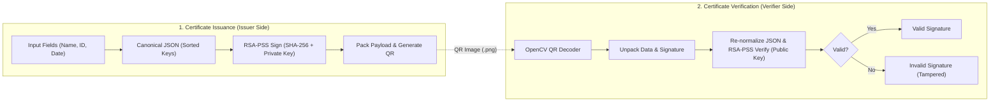
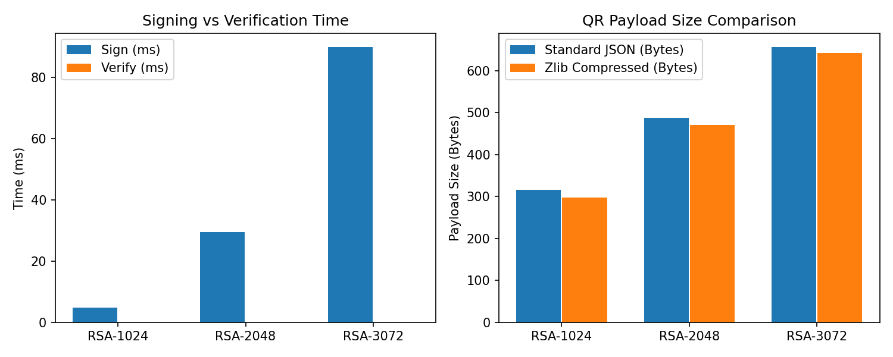
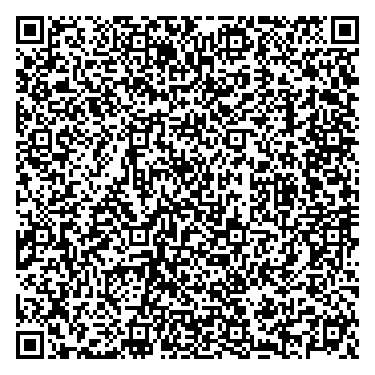

# COVER PAGE *(Excluded from Page Limit)*

**PROJECT REPORT — CRYPTOGRAPHY**

**Title:** Design and Implementation of a QR Code-Based Digital Certificate Verification System Using RSA Digital Signatures

- **Course:** Cryptography
- **Student Name / ID:** [Your Name / Student ID]
- **Instructor:** [Instructor Name]
- **Date:** November 2026

---

# TABLE OF CONTENTS & LIST OF FIGURES *(Excluded from Page Limit)*

### Table of Contents
1. **Introduction** (Page 1)
   - 1.1 Background and Problem Statement
   - 1.2 Objectives and Scope
2. **Theoretical Background and Weakness Analysis** (Page 2)
   - 2.1 Cryptographic Components (RSA-PSS, SHA-256, Asymmetric Keys, QR Code)
   - 2.2 Reproducing Textbook RSA Weakness (Multiplicative Forgery)
3. **System Design and Implementation** (Page 3)
   - 3.1 System Architecture and Operational Workflow
   - 3.2 Payload Optimization Scheme (Compact Binary + Zlib)
   - 3.3 Implementation Details
4. **Experimental Evaluation and Conclusion** (Page 4)
   - 4.1 Security and Tamper Detection Test Cases
   - 4.2 Performance and QR Payload Evaluation
   - 4.3 Limitations and Conclusion
- **References & Annexes** *(Excluded from Page Limit)*

### List of Figures and Tables
- **Table 1:** Roles of Cryptographic and Encoding Components
- **Figure 1:** End-to-End Certificate Issuance and Verification Workflow
- **Table 2:** Functional and Tamper-Detection Test Results
- **Table 3:** Benchmark Results Across RSA Key Sizes (Averaged over 30 Runs)
- **Figure 2:** Signing/Verification Latency and QR Payload Size Comparison

---

<!-- ==================== MAIN CONTENT STARTS HERE (PAGE 1 OF 4) ==================== -->

## 1. Introduction

### 1.1 Background and Problem Statement
Academic and professional institutions increasingly issue digital certificates instead of paper documents. However, plain digital files or printed certificates containing standard QR codes are easy to edit or counterfeit. A typical QR code only encodes text or a URL; it provides no cryptographic assurance of data integrity or issuer authenticity. If an attacker modifies the holder's name or certificate ID and regenerates the QR code, a normal scanner cannot detect the manipulation.

Furthermore, many verification systems rely on a centralized database or web server. If the server goes offline or the verifier has no internet connection, verification fails. This project addresses these problems by designing and implementing an **offline, stateless QR code verification prototype** based on **RSA-PSS digital signatures** and **SHA-256**.

### 1.2 Objectives and Scope
The main objectives of this project are:
1. Standardize certificate fields (`name`, `cert_id`, `issue_date`) into a deterministic format and sign them using RSA-PSS with SHA-256.
2. Reproduce the mathematical weakness of unpadded (Textbook) RSA to demonstrate why probabilistic padding (RSA-PSS) is required.
3. Package the certificate data, Base64 signature, and key identifier (`kid`) into a QR code, and compare standard JSON packaging against a compressed binary packaging scheme.
4. Decode QR images using OpenCV and verify the signature against a trusted public key, accurately detecting any tampering in the certificate data or signature.

**Scope:** The system runs as a local standalone prototype built in Python with an interactive Command-Line Interface (CLI). It does not require user accounts, a database, or a backend server. The verifier is assumed to possess the authentic public key of the issuing organization.

---

<!-- ==================== PAGE 2 OF 4 ==================== -->

## 2. Theoretical Background and Weakness Analysis

### 2.1 Cryptographic Components
The system combines four core components summarized in Table 1.

| Component | Role in the System |
| :--- | :--- |
| **RSA-PSS** | Probabilistic signature scheme used to sign and verify certificate data. |
| **SHA-256** | Cryptographic hash function that produces a 256-bit digest of the normalized certificate data. |
| **Private / Public Key** | The private key $(d, n)$ is kept secret by the issuer to sign data; the public key $(e, n)$ is distributed to verifiers. |
| **QR Code** | Encodes the signed payload into a 2D barcode for optical transmission; QR encoding itself adds no security. |

In RSA key generation, two large primes $p$ and $q$ are chosen to compute the modulus $n = p \cdot q$ and Euler's totient $\phi(n) = (p-1)(q-1)$. With public exponent $e = 65537$, the private exponent is computed as:

$$d \equiv e^{-1} \pmod{\phi(n)}$$

To prevent structural attacks, **RSA-PSS (Probabilistic Signature Scheme)** first hashes the message $M$ using SHA-256 to obtain $mHash = \text{SHA256}(M)$, binds it with a random pseudorandom salt, and applies a Mask Generation Function (MGF1) before modular exponentiation.

### 2.2 Reproducing Textbook RSA Weakness (Multiplicative Forgery)
To justify the selection of RSA-PSS over raw RSA, we reproduced the **multiplicative homomorphism weakness** of Textbook RSA in `demo_textbook_rsa_forgery`. In Textbook RSA, signing a message $m$ directly computes $s = m^d \bmod n$, and verification checks whether $m \equiv s^e \pmod n$.

Because modular exponentiation is multiplicative, an attacker who observes two valid message-signature pairs $(m_1, s_1)$ and $(m_2, s_2)$ can forge a valid signature $s_3$ for a new message $m_3 = (m_1 \cdot m_2) \bmod n$ without knowing the private key $d$:

$$s_3 = (s_1 \cdot s_2) \bmod n = (m_1^d \cdot m_2^d) \bmod n = (m_1 \cdot m_2)^d \bmod n$$

In our experimental test (`run_tests.py`) using a 2048-bit key with $m_1 = 105$ and $m_2 = 200$:
- The attacker computes $m_3 = 105 \times 200 = 21000$ and $s_3 = (s_1 \cdot s_2) \bmod n$.
- When the verifier checks $s_3^e \bmod n$, the result equals $21000$, meaning the **forged signature passes verification (`Forged valid = True`)**.

**How RSA-PSS Fixes This Weakness:** First, SHA-256 destroys algebraic relationships because $\text{SHA256}(m_1 \cdot m_2) \neq \text{SHA256}(m_1) \cdot \text{SHA256}(m_2)$. Second, PSS injects a random salt into every signature, so signing the exact same certificate twice produces two completely different signatures.

---

<!-- ==================== PAGE 3 OF 4 ==================== -->

## 3. System Design and Implementation

### 3.1 System Architecture and Operational Workflow
The system is divided into two independent workflows: **Issuance (Signing)** and **Verification (Scanning)**, illustrated in Figure 1.


*Figure 1: End-to-End Certificate Issuance and Verification Workflow.*

1. **Step 1 (Data Normalization):** The issuer enters the holder's name, certificate ID, and issue date. The function `normalize_cert_data` serializes the dictionary into a canonical JSON string with sorted keys (`sort_keys=True`) and no extra whitespace so that byte representation is identical during signing and verification.
2. **Step 2 (Signing):** `sign_data` hashes the canonical JSON string with SHA-256 and signs it using RSA-PSS (`MGF1(SHA256)` and maximum salt length) with the issuer's private key.
3. **Step 3 (QR Packaging):** The certificate object, Base64 signature (`sig`), and key ID (`kid`) are packed and rendered into a QR code image using `qrcode`.
4. **Step 4 (Scanning & Decoding):** The verifier uploads the QR image. `decode_qr_image` uses OpenCV (`cv2.QRCodeDetector`) with automatic grayscale and resolution fallback to extract the payload string.
5. **Step 5 (Verification):** `verify_signature` re-normalizes the extracted `data` object and verifies the RSA-PSS signature against the trusted public key, returning `Valid Signature` or `Invalid Signature`.

### 3.2 Payload Optimization Scheme (Compact Binary + Zlib)
A practical limitation of RSA signatures in QR codes is signature size: a 2048-bit RSA signature is 256 bytes (344 Base64 characters), and a 3072-bit signature is 384 bytes (512 Base64 characters). If a naive implementation compresses the entire JSON string (including the Base64 signature) and Base64-encodes it again, the high-entropy signature cannot be compressed and expands by $4/3 \times 4/3 \approx 1.78\times$.

To improve this, we implemented a hybrid packing scheme in `pack_qr_payload`:
- Only the structured metadata (`data` and `kid`) is compressed using `zlib` (level 9).
- The compressed metadata is prefixed with a 2-byte big-endian length header and concatenated directly with the **raw binary signature bytes** (`256 bytes` for RSA-2048), then Base64-encoded **only once** with a `C:` prefix.

### 3.3 Implementation Details
The prototype is implemented in Python 3 using:
- `cryptography`: RSA key generation, PEM serialization, and RSA-PSS with SHA-256.
- `qrcode` & `Pillow`: QR code generation across error correction levels (`L`, `M`, `Q`).
- `opencv-python` (`cv2`): Image decoding and QR detection.
- `matplotlib` & Standard CLI (`app.py`): Interactive terminal menu for key management, certificate issuance, QR verification, tampering demos, and automated benchmarking.

---

<!-- ==================== PAGE 4 OF 4 ==================== -->

## 4. Experimental Evaluation and Conclusion

### 4.1 Security and Tamper Detection Test Cases
We executed five automated verification scenarios in `run_tests.py`. The results are shown in Table 2.

| Test ID | Scenario Description | Input File / Condition | Expected Result | Actual Output |
| :--- | :--- | :--- | :--- | :--- |
| **TC-01** | Valid QR code and authentic signature | `qr_valid.png` + `public_key.pem` | `Valid Signature` | **Valid Signature** |
| **TC-02** | Modify holder name (`Nguyen Van A` $\rightarrow$ `Nguyen Van B (Fake)`) after signing | `qr_tampered_data.png` + `public_key.pem` | `Invalid Signature` | **Invalid Signature** |
| **TC-03** | Alter bytes in the Base64 signature string | `qr_tampered_sig.png` + `public_key.pem` | `Invalid Signature` | **Invalid Signature** |
| **TC-04** | Verify authentic QR with a mismatched RSA-2048 public key | `qr_valid.png` + `wrong_public_key.pem` | `Invalid Signature` | **Invalid Signature** |
| **TC-05** | Upload corrupted image / non-QR file | Corrupted byte stream | Clear error message | **Error: Cannot decode QR** |

### 4.2 Performance and QR Payload Evaluation
To evaluate the trade-off between security level, computation speed, and physical QR code density, we benchmarked RSA-1024 (legacy), RSA-2048 (standard), and RSA-3072 (high security) over 30 iterations. Table 3 and Figure 2 present the measured data.

| Key Size | Sign Time (ms) | Verify Time (ms) | Signature (Bytes / B64) | Standard JSON Payload | Compact Payload (`C:`) | QR Version (EC=M) |
| :--- | :--- | :--- | :--- | :--- | :--- | :--- |
| **RSA-1024** | 3.397 ms | 0.015 ms | 128 B / 172 chars | 316 Bytes | 298 Bytes | Version 13 ($69 \times 69$) |
| **RSA-2048** | 22.598 ms | 0.028 ms | 256 B / 344 chars | 488 Bytes | 470 Bytes | Version 17 ($85 \times 85$) |
| **RSA-3072** | 70.811 ms | 0.043 ms | 384 B / 512 chars | 656 Bytes | 642 Bytes | Version 20 ($97 \times 97$) |


*Figure 2: (Left) Signing vs. Verification Time across RSA key lengths; (Right) QR Payload Size comparison.*

**Analysis of Results:**
1. **Asymmetric Computational Cost:** Across all key sizes, verification is **220x to 1,640x faster** than signing (e.g., `0.028 ms` vs. `22.598 ms` for RSA-2048) because verification uses the small public exponent $e = 65537$ ($2^{16}+1$, requiring only 17 modular multiplications), whereas signing uses a 2048-bit private exponent $d$. This makes RSA-PSS highly suitable for client-side verification.
2. **Key Size vs. QR Density:** Increasing key length from 2048-bit to 3072-bit triples signing time (`22.6 ms` to `70.8 ms`) and increases the QR code from Version 17 to Version 20. **RSA-2048** provides the best balance between 112-bit security and optical scan reliability.

### 4.3 Limitations and Conclusion
A valid RSA-PSS signature proves that the certificate payload was signed by the holder of the corresponding private key and was not altered in transit. However, it does not solve public key distribution (trusting who owns the public key requires a PKI or out-of-band channel) or certificate revocation. Despite these scope boundaries, the prototype successfully demonstrates how RSA-PSS, SHA-256, and canonical JSON packaging prevent certificate tampering and forgery in an offline QR verification workflow.

<!-- ==================== MAIN CONTENT ENDS HERE (TOTAL: 4 PAGES) ==================== -->

---

# REFERENCES *(Excluded from Page Limit)*

1. Moriarty, K., Kaliski, B., Jonsson, J., & Rusch, A. (2016). *PKCS #1: RSA Cryptography Specifications Version 2.2* (RFC 8017). IETF. https://doi.org/10.17487/RFC8017
2. National Institute of Standards and Technology (NIST). (2015). *Secure Hash Standard (SHS)* (FIPS PUB 180-4). U.S. Department of Commerce.
3. National Institute of Standards and Technology (NIST). (2023). *Digital Signature Standard (DSS)* (FIPS PUB 186-5). U.S. Department of Commerce.
4. International Organization for Standardization. (2015). *Information technology — Automatic identification and data capture techniques — QR Code bar code symbology specification* (ISO/IEC 18004:2015).

---

# ANNEXES *(Excluded from Page Limit)*

### Annex A: Sample Normalized JSON and Signed QR Payload
- **Normalized Certificate Data (`normalize_cert_data` output):**
  ```json
  {"cert_id":"CERT-2026-001","issue_date":"2026-11-09","name":"Nguyen Van A"}
  ```
- **Generated Valid QR Code (`sample_qrs/qr_valid.png`):**

  

### Annex B: Automated Test Execution Log (`python run_tests.py`)
```text
=== 1. TAO CAP KHOA MAU (RSA-2048) ===
Da luu khoa mau tai thu muc sample_keys/

=== 2. CHAY 5 KICH BAN KIEM THU (TEST CASES) ===
[Case 1] QR va chu ky hop le              -> Valid Signature
[Case 2] Sua ten chung nhan sau khi ky    -> Invalid Signature
[Case 3] Thay doi chu ky                  -> Invalid Signature
[Case 4] Dung Public Key khong khop       -> Invalid Signature
[Case 5] Anh QR hong / sai dinh dang      -> Bao loi: Khong doc duoc ma QR

=== 3. CHUNG MINH DIEM YEU TEXTBOOK RSA vs RSA-PSS ===
Textbook RSA multiplicative forgery (m1=105, m2=200 -> m3=21000): Forged valid = True
```
